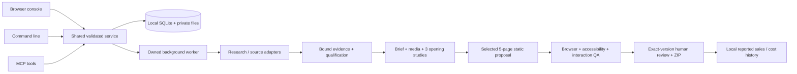

# Application review

Reviewed 28 October 2026 against the uploaded ZIP and the imported code. This is a source/code, offline-test and local-UI review. The original private database, customer media, generated websites, model credentials and historical operational receipts were not included. Statements about past live results in old documents are historical claims, not reproduced outcomes.

This is the original import assessment. The subsequent implemented flows and current acceptance evidence are in [OPERATING-GUIDE.md](OPERATING-GUIDE.md) and [IMPLEMENTATION-VALIDATION.md](IMPLEMENTATION-VALIDATION.md).

## Assessment

Keep this codebase and improve it incrementally. It is a substantial **single-operator local production workbench**, with unusually explicit evidence, job accounting and exact-version review. It is not yet a portable autonomous lead-to-customer business. Its strongest next step is one usable assisted workflow and one measured real proposal, before expanding automated acquisition.

The source snapshot has 58 application modules, 123 existing test files and a vanilla JS/CSS console. The presence of extensive tests is useful, but does not prove lead supply, creative quality or sales. See VALIDATION.md for current executed counts, failures and limits.

## How it works

- **Entry points:** `src/cli.mjs`, `src/mcp.mjs`, and `src/server.mjs` call `src/service.mjs`. The service validates operations with Zod; it delegates batches, assisted intake, seeds, design, recovery and sales to specific modules.
- **Persistence:** `src/db.mjs` initializes/backups SQLite; mostly JSON records sit in relational envelope tables. Jobs, candidate facts, artifacts and events are retained. Private source/model/media files live in state folders; hashes bind stages and review packages.
- **Orchestration:** `src/worker.mjs`, `src/batches.mjs` and `src/batch-budget.mjs` coordinate bounded discovery/build work, deadlines, attempt usage, checkpoints, cancellation and explicit continuations. Worker spawning is local to the machine.
- **Research:** `src/model.mjs` launches an external OpenCode CLI. `src/sources-mcp.mjs` exposes bounded source tools. `src/search.mjs` provides guest Bing or optional Firecrawl search; page extraction is separate in `src/browser.mjs`. `src/seed-source.mjs` and the Python bridge provide optional PlaceRoot pointers.
- **Qualification:** `src/intake.mjs`, `src/screening.mjs` and `src/prospects.mjs` require matching identity, current source evidence, Houston/service-area support, website checks, contact and material. A source listing cannot directly mark a lead qualified.
- **Production:** `src/production.mjs`, `src/craft.mjs`, `src/creative.mjs`, `src/media.mjs` and `src/qa.mjs` stage static assets, render distinct openings, choose a passing direction, build a five-page proposal and test it. A technical pass is not a human acceptance.
- **Review and commercial tracking:** the console exposes actual captures, isolated previews, exact artifact downloads and bounded revisions. `src/sales.mjs` records operator-reported pipeline/money; `src/recovery.mjs` creates bounded idle snapshots and validates fresh-root restores. No sending, public hosting or verified payment service is delivered.

## What is worth preserving

1. One service for UI, CLI and MCP rather than three inconsistent products.
2. Evidence-bound identity and fact checks; unknown/held/excluded states remain explicit.
3. Persisted usage, frozen policy identities and bounded repairs; failed attempts are not erased.
4. Separate static preview origin with restrictive CSP, no model-supplied server execution, host/origin/CSRF guards, path/symlink protections and digest-bound packages.
5. Real browser/accessibility/interaction tests, fixture-negative tests and backup/restore verification.
6. Local-first operation and low dependency count; no framework rewrite is necessary to validate the business.

## Findings and priority

| Priority | Finding and code evidence | Impact / recommended action | Status in this import |
|---|---|---|---|
| P0 | `createRequire` in QA/media/craft/assisted/source MCP and tests points at an unrelated `/home/ai_dev/...` project; packages absent from this manifest | Fresh checkout cannot exercise these features. Declare local dependencies and resolve from each module | Corrected; exact packages locked |
| P0 | DB/credential defaults point to the original operator's directories; tests assume `/tmp/opencode` exists | New machines fail or use an unintended state directory. Use private checkout-local defaults and independent fixture roots | Corrected, existing credential-isolation assertions retained |
| P0 | Browser launches hardcode Brave; shell launcher lacked executable mode after ZIP extraction | Browser checks and direct launcher are not portable | Playwright browser default with optional explicit executable; launcher executable; instructions added |
| P0 | Model generation depends on external `opencode`, exact flags/config schema and `openai/gpt-6.1-sol-fast` route; page extraction depends on `agent-browser` | Local UI availability does not imply live generation/research. Add supported adapter preflight and verify authentication/model availability before spending | Not configured; live model/source work not run |
| P0 | `src/network.mjs` uses direct `https.request` with pinned DNS; it does not consume the cloud's HTTP proxy automatically | Managed cloud egress and proxy-injected credentials may fail even with valid bindings. A correct proxy transport must preserve DNS/private-address defenses and TLS, not simply disable verification | Confirmed transport mismatch by code inspection; live API route untested; fix before real source use |
| P0 | Assisted intake UI requires a complex evidence JSON contract in `web/batches.js` / `src/assisted.mjs` | Nontechnical operator cannot enter a business/photos naturally. Add guided intake and generate the existing contract internally | Product gap; interactive proposed replacement supplied |
| P1 | Branding anchor visible text differed from its `aria-label` in `web/index.html` | New Axe flags `label-content-name-mismatch`; speech/visible name mismatch | Corrected by using the visible link text as the accessible name |
| P1 | Geography is Houston-specific in batch schema, source connector, screening regexes and intake | A free-text area field elsewhere does not make arbitrary cities work. Centralize explicit geography policy with migration and negative tests | Deliberately unchanged; roadmap item |
| P1 | Automatic no-site lane excludes independent websites; assisted booking/social lane has separate rules | A weak-site redesign market is not currently supported merely by changing marketing copy | Define separate redesign qualification and media policy |
| P1 | Assisted payload is capped at 1 MiB of JSON; individual base64 field capped at 950,000 chars, while decoded-media checks allow more | Real photo dossiers can exceed the practical limit; JSON/base64 overhead further reduces usable media. Use bounded staged uploads with hash/provenance binding and consistent UI/API limits | Documented; no unsafe global body-size increase |
| P1 | `src/db.mjs` general collections are capped at 300 and `snapshot()` uses these | A long-running studio can lose older work from general UI views. History endpoints exist but do not replace consistent pagination everywhere | Add keyset pagination and indexed state projections |
| P1 | Generation worker launches are counted, not provider completions/tokens or dollars | Attempt caps are not reliable dollar budgets or margin accounting | Add attributable cost receipts, unknown-spend state and reservation policy |
| P1 | `src/promotion.mjs` requires a separate original business-library project; reference imports include fixed original directories | Library promotion/reference actions remain machine-bound even after core startup repair | Keep optional integration disabled until standalone export/adapter is implemented |
| P1 | Original README/AGENTS mixes dozens of historical outcomes and authorizations with setup | Developers cannot identify current product state; historical instructions may be mistaken for live authority | Replaced with concise current docs; original archive preserved outside repository |
| Later | Loopback app has no account/tenant authorization and relies on local trust; source services run as local children | Do not bind it publicly or expose it through a generic tunnel as a SaaS | Add real authentication, tenancy, isolation and operations before hosted deployment |

These are engineering/product findings, not a full security audit or certification. Preserve the existing host/path/source defenses when changing transport or introducing hosting.

## UI/UX review

Actual captures: [desktop](visuals/current-desktop.png) and [phone](visuals/current-mobile.png). The app was inspected with a new empty private database. No old customer output is available to evaluate.

The visual foundation is coherent: editorial typography, a restrained studio palette, numbered navigation, honest status and no decorative success metrics. The console loads without browser JavaScript errors and the checked empty start view reflows at phone width.

The first-use screen still exposes too much implementation vocabulary: preset adoption, worker launches, source allowance, evidence JSON and optional diagnostic services. Guided and legacy flows coexist. A broken or unavailable library link points to another local service. A person trying to make one website needs an obvious first action and prerequisites rather than an operational control panel.

Proposed primary navigation: **Workspace → Opportunities → Business brief → Website review**; keep integrations, budgets, history and recovery in secondary settings. Every blocked item should say what is missing, why it matters and the next supported action. Put source detail in an evidence drawer; keep uncertainty visible on the card. In review, lead with the actual site and desktop/phone controls, then facts/media/technical checks and version-bound feedback.

[Interactive visual proposal](UX-PROTOTYPE.html): fictional leads, working search/filter, evidence dialog, lead-to-brief handoff, review-width toggle and a clearly labelled demo decision. This is a self-contained design prototype; it is not wired to the app and does not generate, send or publish anything. It includes the actual current screenshots for comparison.

## GitHub and ownership

The selected remote is **public**, verified from its repository page during this review. The user explicitly approved uploading this prepared branch publicly after reviewing the import scope and public visibility. No credentials were found by the limited credential-pattern scan; this is not proof that all confidential content or licensing issues have been eliminated. No private state, real customer media, generated review sites, original operational diary or historical agent directives were imported. Synthetic security fixtures may contain strings deliberately resembling unsafe values; they are not live credentials.

No app-wide license was supplied. Do not assign a permissive license without an ownership decision. The bundled OFL notices remain. Current package `private: true` prevents accidental npm publication; it does not make a GitHub repository private.
